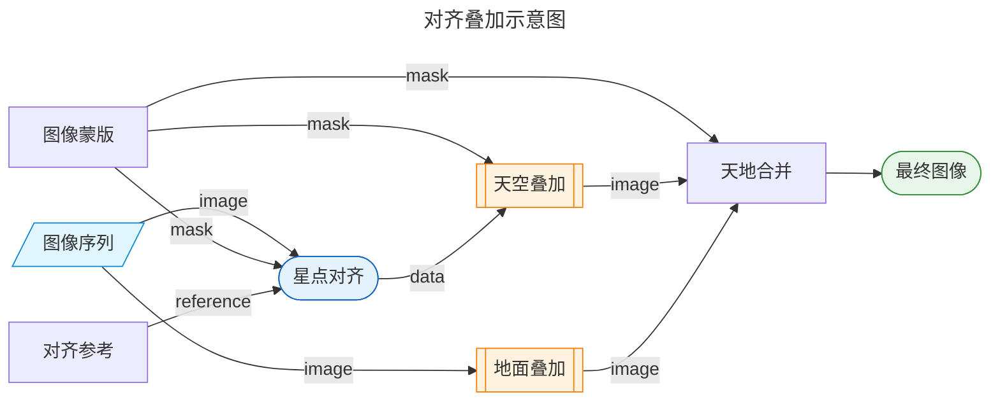

# HoshinoWeaver v1.2.0-beta.0 用户使用指南

本手册旨在帮助用户理解各模块的功能和参数，并提供从准备素材到输出结果的完整流程指引。

---

## 名词解释

- **工作流**：接受特定输入、产生特定类型输出的计算方式。需要根据你希望得到的产物来选择工作流。例如，"生成星轨"和"堆栈降噪"是不同的工作流，在开始前需要明确选择。

- **模式**：工作流内不同具体计算方式的选项。为达到同一工作流的结果，可能存在多种不同的处理模式。不同模式下可选的参数选项及产出效果可能存在差异。例如，星轨叠加中有"最大值叠加"和"噪声均匀化"两种模式。

- **参数选项**：确定工作流和模式之后，用户将被提供一系列详细的可选参数，用于控制某个功能是否启用、具体的运行参数，以及某些结果是否参与最终输出。

> [!TIP]
> 在图形界面的工作流，模式和参数选项标题上悬浮，会显示相关的说明文本和推荐选项。

---

## 快速上手

### 第一步：确定你想要的结果，选择工作流

| 我想要… | 使用工作流 |
|---|---|
| 将多张图像合成一张星轨照片 | [星轨叠加](#星轨叠加) |
| 多张图像叠加降噪（模拟慢门、流云、流水等） | [堆栈降噪](#堆栈降噪) |
| 将多张图像合成为一张天空按星点对齐降噪，且地景不会因对齐旋转而模糊的星空照片 | [对齐叠加](#对齐叠加) |
| 生成星轨随时间变化、带拖尾或渐隐效果的图像序列 | [星轨延时](#星轨延时) |
| 对延时星空逐帧对齐降噪，保留星空随时间变化的运动 | [延时降噪](#延时降噪) |

> [!NOTE]
> 启动时默认工作流为“星轨叠加”。如果需要切换，请单击软件顶部的工作流名称，在下拉框中选择希望使用的工作流。

### 第二步：导入图像文件

在"图像文件"输入区域选择全部待处理的图像。支持格式包括 `.tif`、`.tiff`、`.fits`、`.png`、`.jpg`、`.jpeg`，以及 `.cr2`、`.cr3`、`.nef`、`.arw`、`.dng`、`.rw2`、`.orf`、`.raf` 等常见 RAW 格式，以及 `.fts` 等天文数据格式。

对于渐入渐出、去卫星线和延时工作流，应确保输入序列按拍摄先后排列；使用对齐叠加中的联合对齐模式和延时降噪工作流时，应使用同一相机、同一镜头及焦距拍摄的序列。

### 第三步：（可选）准备遮罩文件

部分功能可以准备**遮罩**图像，即一张**白色代表天空区域、黑色代表地面区域**的图像，建议与原始图像尺寸相同。软件内置了天空蒙版编辑器，可以自动生成并手动修正，也可事先在 Photoshop 等软件中绘制后导入。尺寸适配与制作方法详见[附录 C：遮罩文件制作说明](#附录-c遮罩文件制作说明)。

以下功能可选使用遮罩：
- 星轨叠加 → 去卫星线（用于限定星点检测区域）
- 星轨叠加 → 噪声均匀化模式（可用于将天空与平均值叠加地景融合）
- 星轨延时 → 去卫星线（用于限定星点检测区域）

以下功能必须提供遮罩：
- 对齐叠加 → 叠加地面（仅处理天空时也推荐使用，减少地面影响）
- 延时降噪 → 启用地景降噪（仅处理天空时也推荐使用，减少地面影响）

### 第四步：选择模式和参数

参考各工作流章节选择合适的模式和参数。对于初次使用，保持默认参数通常能获得不错的结果。

### 第五步：设置输出，执行

在输出设置区域选择输出路径和文件格式，然后点击执行。

- **单张图像工作流**：指定输出文件名；JPG 支持 8 位，PNG 支持 8/16 位，TIFF 支持 8/16/32 位。
- **星轨延时、延时降噪**：可保存逐帧图像、直接导出视频，或同时输出两者。详见[序列与视频输出设置](#序列与视频输出设置)。

启动前会检查配置合法性并估算资源需求；如果提示配置有误，先修正对应选项。运行中也可以随时点击停止按钮中止任务。

---

## 工作流

目前 HoshinoWeaver 提供五个主要工作流：

1. **[星轨叠加](#星轨叠加)**：将多张图像合成单张星轨照片。
2. **[堆栈降噪](#堆栈降噪)**：多张图像叠加求统计值，不进行星点对齐（可用于模拟慢门、流云、平滑水面等）。
3. **[对齐叠加](#对齐叠加)**：带星点对齐的叠加，可分别处理天空和地面区域，产出高信噪比的星空图像。
4. **[星轨延时](#星轨延时)**：按滑动窗口或指数衰减生成逐帧星轨图像序列。
5. **[延时降噪](#延时降噪)**：每个窗口中心帧为参考进行叠加，可用于降噪或者去闪，输出延时图像序列。

---

## 星轨叠加

将多张连续拍摄的图像合成为一张包含完整星轨的照片。

### 模式选择

星轨叠加支持两种模式：

#### 最大值叠加

逐像素取所有帧的最大值。计算简单，速度极快。

**适合以下情况**：
- 素材 ISO 较低，画面噪声较少
- 图像未经过镜头畸变校正
- 地景干净，无明显亮度波动

#### 噪声均匀化

在最大值叠加的基础上，引入均匀化校正算法，消除因镜头校正引入的空间亮度不均和高频纹理伪影，并可选择将背景亮度还原至均值叠加水平。

**适合以下情况**：
- 素材已在前期或其他软件中应用了镜头畸变校正（暗角补偿、畸变矫正）
- 叠加后出现边角偏亮或环状纹理伪影
- 地景受到短时的光照影响，需要排除噪声
- 希望输出结果和平均值地景图像亮度匹配，方便融合

> 关于算法原理，详见[附录 B：噪声均匀化原理](#附录-b噪声均匀化原理)。

---

### 参数说明

#### 星轨效果

**渐入/渐出**

创建星轨双端渐隐效果（类似Photoshop"半岛雪人"插件），使星轨首尾自然淡入淡出。通过双端滑条控制，左端设置渐入比例，右端设置渐出比例。

例如，左右分别设置为 0.2 和 0.7，则：
- 前 20%：渐入
- 20%–70%：完整星轨
- 末 30%：渐出

设置为 0 和 1.0（默认）时，不产生渐隐效果。

---

#### 预处理

**缩星**

在叠加前，对每张图像应用缩星处理，缩小图像中的星点。

启用后可选择**缩星力度**：轻度、适中、较强、强力、去星，默认“适中”。力度越高，星点被压制得越明显；“去星”适用于希望显著去除星点的效果，不适合作为保留完整星轨时的常规选择。

适合使用大光圈、高感光度拍摄的序列，或星点过于密集时，可通过缩星使输出的星轨线条更纤细，密度降低，不过于拥挤。

**去卫星线**

在叠加过程中自动检测并去除图像中的卫星轨迹、飞机轨迹等线型干扰。算法通过对比相邻若干帧（帧数通过"去卫星窗口大小"配置）来识别和排除干扰。

- **去卫星窗口大小**：检测窗口的帧数范围。值越大，去除越彻底，但会增加计算时间。推荐设置为 3；仅对特别密集的航线，可适当增大。该选项仅在启用"去卫星线"时显示。

**焦距信息**（去卫星线）

默认选择“读取 EXIF”，去卫星线会使用每一帧的 EXIF 焦距信息来估计旋转；EXIF 缺失或不完整时，程序使用 20mm 等效焦距作为兜底值。

选择“手动指定”后，界面会显示**镜头焦距（mm）**和**传感器裁切系数**。焦距应填写实际焦距；全画幅裁切系数为 1.0，35mm 等效焦距 = 实际焦距 × 裁切系数。手动模式会忽略输入图像中的 EXIF 焦距。

**天空区域遮罩**（顶层）

提供仅标注天空区域的遮罩图像。如使用去卫星线功能，则强烈推荐绘制天空区域遮罩：这将避免地面亮光源干扰星点检测，以及去卫星线功能影响地面画质。天空区域遮罩可以不用非常精细，天地交接部分可以适当用黑色多覆盖一些。

---

#### 噪声均匀化参数

以下参数仅在选择"噪声均匀化"模式时显示。

**暗像素排异阈值 (σ)** 和 **亮像素排异阈值 (σ)**

算法在估算背景噪声时使用 Sigma 裁剪剔除异常像素。这两个参数分别控制剔除偏暗和偏亮像素的激进程度，值越小则剔除越多。通常无需修改默认值。参数详解见[附录 A：Sigma 裁剪参数说明](#附录-asigma-裁剪参数说明)。

**最大迭代次数**

Sigma 裁剪的最大迭代轮数。通常无需修改。参数详解见[附录 A：Sigma 裁剪参数说明](#附录-asigma-裁剪参数说明)。

**天空区域遮罩**（噪声均匀化，可选）

此处的遮罩用于天地融合：启用后，输出图像中天空区域使用星轨叠加结果，地面区域使用 Sigma 裁剪均值结果融合，可同时得到清晰星轨和低噪声地景。

**还原均值亮度**

开启后，算法将背景亮度降至均值叠加水平，使星轨的对比度更突出，与单独拍摄的平均值地景图像亮度匹配，方便后期融合。关闭则仅消除空间不均匀性，保留最大值叠加的整体亮度特性。

---

## 堆栈降噪

将多张图像叠加，通过统计方法降低噪声，不进行星点对齐。适合模拟慢门（流云、流水、平滑海面）、拍摄固定场景的降噪叠加等用途。

### 算法选择

| 算法 | 适用场景 | 说明 |
|---|---|---|
| **均值** | 干净素材，无异常帧 | 最快最锐利，直接求平均，不排除任何异常值 |
| **Sigma 裁剪** | 有异常帧（车灯、飞机、闪光），张数较多（>10 张） | 多轮迭代剔除异常像素后求平均，结果更干净 |
| **中位数** | 有异常帧，张数偏少（<10 张） | 逐像素取中位数，天然排除异常值，无需额外参数，但速度较慢 |
| **Huber 均值** | 轻微异常，希望结果平滑 | 自动降低异常像素的权重，通过 Huber 常数 c 控制压制程度 |

#### Sigma 裁剪参数

选择 Sigma 裁剪算法时，可配置排异阈值和迭代次数。参数详解见[附录 A：Sigma 裁剪参数说明](#附录-asigma-裁剪参数说明)。

#### Huber 均值参数

**Huber 常数 c**：控制对异常像素的权重接受程度。值越小，异常像素被压制得越彻底；值越大，结果越接近普通均值。通常保持默认值即可。

---

## 对齐叠加

将多张星空照片按星点对齐叠加为一张星点清晰、噪声极低的图像。算法将所有图像对齐到同一参考帧的星点位置，再分别对天空和地面区域进行叠加，输出高信噪比的星空图像，同时避免地景因旋转产生拖影。

### 准备遮罩文件

遮罩文件用于告知软件哪些区域是天空、哪些区域是地面。无论是否叠加地面，都推荐设置遮罩：即使只叠加天空部分，遮罩也可以确保叠加天空时不会有地面图像影响叠加效果。

遮罩文件要求：
- 建议与原始图像尺寸相同。计算时的尺寸适配说明见[附录 C](#附录-c遮罩文件制作说明)
- 白色（`#ffffff`）区域 = 天空
- 黑色（`#000000`）区域 = 地面
- 文件格式：`.tif`、`.tiff`、`.png`、`.jpg`

关于如何制作遮罩，详见[附录 C：遮罩文件制作说明](#附录-c遮罩文件制作说明)。

### 对齐方式选择

在工作流下拉框中选择“对齐叠加”，再选择以下对齐方式。当前默认使用**联合对齐**。

| 对齐方式 | 适用素材 | 参考帧与特点 |
|---|---|---|
| **直接对齐** | 需要对齐到序列外的参考图，或输入图像来自不同的相机/镜头 | 每帧独立对齐到指定的“对齐基准帧”，泛用性好，速度较快；参考图可来自序列外部 |
| **联合对齐** | 使用同一相机、同一镜头及焦距拍摄的序列 | 共享相机参数，联合优化各帧指向，准确度与一致性更好；参考帧必须来自输入序列 |

#### 直接对齐

先指定一张星点清晰、与输入图像有足够重叠的**对齐基准帧**，再选择具体的对齐方式：

| 对齐方式 | 适用素材 | 说明 |
|---|---|---|
| **透视变换** | 已进行镜头畸变校正的图像 | 默认选项，计算较快；不适合明显未校正畸变的图像 |
| **畸变校正** | 未校正畸变的标准镜头或鱼眼图像 | 构建相机模型，同时优化镜头焦距和畸变；应提供可靠的 EXIF 或手动相机信息作为初始参考值 |

选择“畸变校正”后，**相机信息**可设为：

- **读取 EXIF**：从照片中读取相机和镜头信息。
- **指定同一相机**：用于 EXIF 不完整的同相机素材，选择镜头类型并填写实际焦距、传感器裁切系数。
- **指定不同相机**：用于 EXIF 不完整的不同相机素材，可分别指定参考帧和输入帧的镜头类型，支持标准镜头与鱼眼之间的对齐；应保留各自的 EXIF 信息。

#### 联合对齐

联合对齐使用多帧 Bundle Adjustment（BA）算法，利用整段序列的星点匹配共同求解相机参数和每帧指向。

- **参考帧序号**：从 0 开始计数，例如 0 为第一张。未指定时使用序列中间帧。
- **联合优化焦距**：默认开启，利用全序列匹配优化共享焦距。
- **联合优化畸变**：默认开启，利用全序列匹配优化共享畸变。

#### 镜头信息与中心偏移

**镜头类型**与[直接对齐](#直接对齐)中可配置的**相机信息**一致。

**中心偏移**：对于已知进行过裁切或镜头光心偏心的图像，可开启该选项，改善求解相机模型的准确度。

> [!TIP]
> 当前已支持标准镜头和鱼眼镜头。大畸变边缘、星点稀少或图像间重叠较低时仍可能对齐不佳；优先使用星点清晰、重叠充分的素材，必要时提供天空遮罩，排除地面亮光源的干扰。

### 叠加算法选择

**天空叠加算法**和**地面叠加算法**分别配置，互相独立。

天空和地面的特点不同，建议的选择策略：

- **天空**：有卫星/飞机线或其他异常值时，推荐 Sigma 裁剪（>10 张）或中位数（<10 张）；素材干净时使用均值即可。
- **地面**：通常使用均值即可；若地景中有车辆通行、人影等干扰，推荐 Sigma 裁剪或中位数。

均值、Sigma 裁剪、中位数和 Huber 均值的详细说明与选择依据同[堆栈降噪 → 算法选择](#算法选择)。

此外，天空和地面均可选择**最大值**或**最大值混合**：前者逐像素保留最亮值，后者在最大值基础上校正空间亮度不均。这两种算法可用于保留飞机、卫星等明亮轨迹，不适合去除这些干扰。

### 是否叠加地面

**叠加地面**开关：
- **开启**：配合天空遮罩，天空按对齐叠加，地面不做几何变换而单独叠加，最后融合为完整画面。要实现天地分离，请同时提供遮罩。
- **关闭**：仅叠加天空部分；如果配置了遮罩，地面区域将为黑色；如果未配置遮罩，地面会因星点旋转对齐而产生拖影。

---

## 星轨延时

将连续拍摄的图像处理为逐帧星轨序列，用于制作星轨延时动画。输入帧按时间顺序参与处理，星轨随窗口移动或亮度衰减而变化。

### 延时模式

| 模式 | 效果 | 主要参数 |
|---|---|---|
| **滑窗最大值** | 对当前帧及之前若干帧逐像素取最大值，窗口外的旧轨迹直接退出 | 窗口大小 |
| **指数衰减** | 旧轨迹逐帧变暗，与当前帧取最大值，形成平滑渐隐的彗星尾效果 | 半衰期 |
| **渐入渐出** | 对滑窗内图像按渐入渐出权重取最大值，控制轨迹两端的淡化 | 窗口大小、渐入/渐出 |

**窗口大小**：每张输出最多使用多少张输入图像，默认 30 帧，界面范围为 1–300 帧。值越大，星轨通常越长。滑窗模式在序列开头不足一个窗口时，使用已有帧输出，因此开头的星轨会逐渐增长。

**半衰期**：仅用于指数衰减，表示旧轨迹的贡献衰减到一半所需的帧数，默认 30 帧，界面范围为 1–300 帧。值越大，旧轨迹保留越久；它没有固定的窗口截断边界。

**渐入/渐出**：仅用于“渐入渐出”模式，滑条含义同[星轨效果](#星轨效果)，但比例作用于每个滑动窗口，而不是整段输入序列。该模式每帧都需处理窗口内的加权图像，通常比前两种模式慢。

### 预处理与输出

可启用**缩星**并选择力度，也可启用**去卫星线**、选择焦距信息来源、设置去卫星窗口大小及天空区域遮罩，用法同[星轨叠加的预处理](#预处理)。此处遮罩仅用于去卫星线的星点检测，不提供独立的地景降噪融合。

在输出区域选择图像序列、视频或同时输出，保存方式见[序列与视频输出设置](#序列与视频输出设置)。

---

## 延时降噪

将同一相机、同一镜头及焦距拍摄的延时序列逐帧降噪。软件先用联合对齐求解全序列，再将每个窗口内的天空对齐到**该窗口中心帧**后叠加。因此输出保留星空随时间变化的位置。

### 相机与联合优化

镜头类型、实际焦距、传感器裁切系数、联合优化焦距、联合优化畸变及中心偏移的含义同[对齐叠加](#对齐叠加)。EXIF 完整时可使用自动读取；缺失时应手动补齐相机信息。

### 天空与地景窗口

- **星空窗口大小**：以当前输出对应的中心帧为中心，取前后邻近帧进行对齐叠加。默认 5 帧；序列两端会自动缩小窗口。
- **启用地景窗口**：配合“天空/地景蒙版”，对黑色区域使用未做几何变换的地景叠加结果，与白色区域的天空结果融合。未提供蒙版时输出天空对齐结果，无法实现天地分离。
- **地景窗口大小**：独立控制地景叠加帧数，默认 5 帧。可设为 1，以保留当前帧的地景；增大窗口可平滑地景变化，也可能使运动物体模糊。

两个窗口大小均要求正奇数，界面范围为 1–31 帧。当前天空默认至少需要 2 张有效对齐帧，因此星空窗口应从 3 帧起选；虽然界面允许设为 1，但该值不满足默认的最少贡献帧数要求。

例如，星空窗口设为 5、地景窗口设为 1，并启用地景窗口、提供蒙版，可在用邻近帧降低天空噪声的同时保留当前时刻的地景。

**星空叠加算法**与**地景叠加算法**可分别选择均值、最大值、中位数或 Sigma 裁剪。干净素材可使用均值；有飞机线等干扰时，小窗口可使用中位数，较大窗口可使用 Sigma 裁剪。最大值会保留明亮轨迹。Sigma 裁剪参数的含义见[附录 A](#附录-asigma-裁剪参数说明)。

### 后处理与输出

可在窗口叠加后启用**缩星**并选择缩星力度。可输出图像序列、视频或同时输出，保存方式见下一节。

若中心帧未成功对齐，或窗口内有效帧数不足，对应输出帧会被跳过，输出张数可能少于输入张数。

---

## 序列与视频输出设置

序列输出的工作流（星轨延时和延时降噪）的输出面板分别提供“输出序列”和“导出视频”开关。默认只启用图像序列；可以单独启用任意一种，也可同时启用，至少保留一项。

### 图像序列

启用“输出序列”后配置：

- **输出目录**：逐帧图像的保存位置。
- **图像格式与位深**：PNG、TIFF 支持 8/16 位；JPG 为 8 位。需要继续后期处理时，可选择 16 位 PNG 或 TIFF。
- **文件名模板**：使用 `{index}` 表示从 0 开始的输出序号。例如，`frame_{index:05d}.png` 会生成 `frame_00000.png`、`frame_00001.png` 等文件。模板不含占位符时，程序自动在扩展名前加入序号。自定义模板的扩展名应与所选格式一致。

延时降噪还支持用 `{frame_index}` 保留对应的原始中心帧序号，例如 `frame_{frame_index:05d}.tif`；有帧被跳过时，文件序号会保留空缺，便于定位原素材。星轨延时使用 `{index}`。

### 视频格式与编码

启用“导出视频”后指定目标文件，选择文件格式和编码。需要可用的 FFmpeg，配置方法见[附录 D](#附录-d全局设置与组件检测)。

| 格式与编码 | 用途与特点 |
|---|---|
| **MP4 / H.264** | 适合日常播放与分享，文件较小；兼容性优先时可保留默认 4:2:0 色度采样 |
| **AVI / H.264** | 使用 H.264 压缩，保存为 AVI 容器 |
| **AVI / 无压缩 RGB** | 不进行视频压缩，文件很大、磁盘写入压力高；仍为 8 位 RGB，不等同于 16 位图像序列 |

当前视频输出均为 Rec.709 SDR、8 位。若需要保留更高位深用于后期处理，应同时或单独保存 16 位图像序列。无压缩 AVI 不内嵌色彩标签，后期软件中应按 Rec.709 解释。

### 视频参数

| 参数 | 说明 |
|---|---|
| **帧率** | 每秒播放多少帧，默认 25；只影响播放速度，与软件处理速度无关。例如 250 张输出帧以 25 fps 播放，时长约 10 秒 |
| **宽度／高度** | 0 表示自动。只指定一边时按比例计算另一边；两边都指定时，在该边界内等比例缩放。H.264 的部分色度采样模式会自动调整为偶数尺寸 |
| **质量模式** | H.264 可选恒定质量或目标码率。恒定质量适合优先保持画质；目标码率适合需要控制输出体积的场景 |
| **恒定质量（CRF）** | 默认 18，范围 0–51，越小质量越高、文件通常越大；只在恒定质量模式下生效 |
| **目标码率** | 以 kbps 为单位，默认 12000；只在目标码率模式下生效，实际体积仍会随素材和编码过程变化 |
| **编码速度** | H.264 默认 medium。较慢的预设通常以更多计算换取更好的压缩效率 |
| **色度采样** | H.264 可选 4:2:0、4:2:2、4:4:4。后两者保留更多颜色细节，但播放器兼容性可能较差 |
| **色彩范围** | H.264 可选 limited/full，通常保留默认 limited；无压缩 RGB 固定 full |
| **输入色彩** | 默认自动使用传入的 ICC；普通无 ICC 图像按 sRGB 解释。仅在明确知道实际像素空间时手动指定，避免错误转换 |

无压缩 RGB 不使用 CRF、码率、编码速度、色度采样等压缩参数，相应选项会隐藏或禁用；帧率、尺寸和输入色彩设置仍然有效。

### 完成与停止

任务结束时还需等待视频编码器完成封装。成功后可点击“打开已导出视频”，使用系统播放器查看结果。

---

## 附录

### 附录 A：Sigma 裁剪参数说明

Sigma 裁剪（Sigma Clipping）是一种迭代异常值剔除算法：每轮计算当前像素集合的均值和标准差，剔除偏离均值超过设定倍数（sigma 值）的像素，重复直到没有新的像素被剔除或达到最大迭代次数。

**亮像素排异阈值 (σ)**：高于均值多少个标准差视为偏亮异常像素并排除。值越小，排除越激进。推荐范围 2.5–3.5；降低到 2.0 以下可能误排正常像素。

**暗像素排异阈值 (σ)**：低于均值多少个标准差视为偏暗异常像素并排除。通常与亮像素阈值保持一致。推荐范围 2.5–3.5。

**最大迭代次数**：算法最多执行多少轮迭代。大多数情况下 3–5 次迭代已收敛，无需增加。增大此值会略微增加计算时间。

> Sigma 裁剪适合帧数较多（>20 张）的情况。帧数偏少时，可改用中位数，无需配置阈值参数。

---

### 附录 B：噪声均匀化原理

本节为对算法原理感兴趣的用户提供简要说明，不影响软件的正常使用。

#### 问题来源

星轨叠加通常使用"最大值叠加"：对每个像素取所有帧中的最大值，星星经过的区域因此会留下完整轨迹。

然而，当输入图像已经过**镜头畸变校正**（包括暗角补偿和畸变矫正），画面不同位置的噪声方差会变得不均匀：
- 暗角补偿会放大边缘区域的噪声
- 畸变矫正的插值操作会引入周期性的噪声方差变化，形成环状纹理

在均值叠加中，这些差异会因统计平均而抵消，肉眼不可见。但最大值叠加会**将噪声的空间不均匀性放大**，导致边角偏亮或出现环状摩尔纹伪影。

#### 解决思路

噪声均匀化的核心思路是：**不消除噪声，只均匀化噪声**。

算法通过 Sigma 裁剪逐像素估算每个位置的噪声标准差，得到一张"噪声方差分布图"，再根据各位置噪声偏高或偏低于全图中位数的程度，对最大值叠加结果做加减校正，将整幅图像的噪声底面拉齐到统一高度。

星星经过的像素（信号远强于噪声）不受影响，只有纯背景区域会被校正。

**"还原均值亮度"选项**：如果同时启用该选项，算法会进一步将背景亮度还原至均值叠加的水平（而非最大值叠加的统计均值），使结果图像更容易和平均值地景图像直接融合。

#### 局限性

- 需要足够多的帧数（推荐 ≥ 50 张）来稳定估算逐像素噪声方差
- 如果拍摄期间天空亮度发生明显变化（如月升月落），噪声估算可能出现偏差
- 仅对已应用镜头校正的素材有明显改善效果；未校正的素材通常不会有类似纹理，使用"最大值叠加"即可

---

### 附录 C：遮罩文件制作说明

遮罩文件用于告知软件图像中天空和地面的分界，在去卫星线（含星轨延时）、噪声均匀化地面融合、对齐叠加以及延时降噪工作流中使用。

#### 使用内置天空蒙版编辑器

1. 在主界面展示一张参考图作为自动生成天空蒙版的底图。
2. 点击预览区顶部的蒙版编辑器图标，或点击任一蒙版参数旁的“编辑”，打开蒙版编辑器。
3. 编辑器中，点击“自动生成”即可从当前图像生成天空蒙版。也可以点击“加载蒙版”导入已有的 PNG/JPEG 蒙版进行验证或微调。
4. 自动生成的蒙版可能不准确，可使用画笔微调修正结果。选择“画天空”或“画地面”确认修正模式，在图中可进行左键绘制，右键平移，滚轮缩放等操作。支持调节笔刷大小、反相、撤销和重做。
5. 订正完成后，需将图像保存到本地。从参数旁入口进入时，可点击“保存并应用”，保存成功后会自动填入该参数。

编辑器可切换原图、纯蒙版和彩色叠加视图，叠加透明度可调，便于检查地平线边界。保存文件为无损 PNG，白色代表天空、黑色代表地面。

#### 保存、应用与主预览

- **保存**：只写出蒙版文件。从预览区入口打开时，保存后需要自行在工作流参数中选择该文件。
- **保存并应用**：仅从蒙版参数旁进入时提供，保存后回填原参数，并在主预览中叠加该蒙版。可通过预览区工具栏切换蒙版显隐。
- 应用后，浏览同尺寸的其他图片可沿用叠加预览；不同尺寸图片不拉伸蒙版，显隐按钮会禁用并说明原因。

编辑器使用打开时主界面展示图的快照。在主界面浏览其他图像不会自动更换编辑底图；需要更换时，重新从入口打开编辑器。切换工作流或改变相关模式后，原参数的回填目标可能失效，此时仍可保存文件，再到新参数中手动选择。

#### 使用外部绘图软件

1. 在 Photoshop、GIMP 或其他图像编辑软件中打开任意一张原始图像
2. 新建一个图层，填充为**纯黑色**（`#000000`）
3. 用画笔工具将**天空区域**涂抹为**纯白色**（`#ffffff`）
4. 地平线附近无需完美贴合，留有数十像素的余量即可
5. 保存为 `.tif` 或 `.png` 格式，与原始图像放在同一目录下

#### 注意事项

- 推荐使用与原始图像相同或接近尺寸和构图的遮罩。工作流计算时可自动缩放尺寸不同的蒙版，但仍应检查缩放后的边界是否正确。编辑器则要求参考图与载入蒙版尺寸严格一致，不会自动缩放
- 地平线位置固定的序列只需制作一张遮罩，软件会应用到整个序列；暂时不支持动态序列的遮罩
- 遮罩中只需区分天空和地面，不需要精细抠图；粗略的边界通常已足够。
- 天地交接部分可以适当用黑色多覆盖一些。

### 附录 D：全局设置与组件检测

可以通过主界面右上角的设置菜单打开“全局设置”或“组件检测”。

#### 全局设置

全局设置用于配置所有工作流共用的基础配置；对于需要配置的项，应启用该条目并填写相应值。条目未启用表示不使用该全局覆盖值。目前支持以下条目：

| 名称 | 用途与配置 |
| ---- | ---------- |
| 整数权重（`int_weight`） | 在支持的计算中采用整数加速计算。通常保持开启。 |
| 星点检测策略（`star_detection_mode`） | `auto` 为自动模式，在原生检测校验失败时回退；`native_relaxed` 为原生宽松模式，放宽一致性校验以提高速度；`contour` 使用原生轮廓检测。部分情况可能影响星点对齐及去卫星线等功能的效果。 |
| 自动恢复变形星点（`star_detection_recovery`） | 根据候选星点被形状过滤的比例，尝试恢复被排除的变形星点，改善画面边角星点劣化时的检测。|
| 中间帧缓冲模式（`buffer_mode`） | 在需要多次读取中间帧时，`memory` 将中间帧保存在内存中，减少磁盘读写；`disk` 使用磁盘临时文件，降低常驻内存需求，但需要额外磁盘空间。 |
| 资源不足自动降级（`auto_fallback`） | 允许启动前预检在资源不足且存在可用降级方案时自动调整执行配置，例如降低缓冲的内存需求。关闭时需按预检提示自行处理。 |
| 自动规划分块大小（`runtime_planner`） | 对支持分块的算法，根据可用内存、图像尺寸和帧数自动选择每次处理的行数，在内存占用与处理效率之间取舍。通常保持开启。 |
| 临时文件目录（`temp_path`） | 指定磁盘帧缓冲的存放位置，留空使用系统临时目录。建议选择空间充足的本地 SSD。 |
| FFmpeg 可执行文件（`ffmpeg_path`） | 指定视频导出使用的 FFmpeg。留空时自动从应用附近的 `external` 目录及系统 PATH 查找；仅输出图像时无需配置。 |
| Photoshop 程序路径（`photoshop_path`） | 指定 Windows 的 `Photoshop.exe` 或 macOS 的 `.app`，供实验性 RAW 后端调用。还需在支持的工作流中将“RAW 解码方式”切换为 Photoshop。 |
| 日志级别（`log_level`） | 设置日志输出的最低级别：`DEBUG` 最详细，适合排查问题；`INFO` 显示常规运行信息；`WARNING` 仅显示警告和错误；`ERROR` 仅显示错误。 |
| 默认格式（`output_format`） | 设置输出面板时的默认图像格式，可选 JPG、PNG、TIFF。 |
| 输出数据类型（`output_dtype`） | 设置图像输出的默认位深：`uint8`、`uint16`、`uint32` 分别为 8、16、32 位无符号整数。 |
| JPG 图像质量（`jpg_quality`） | JPG 输出的默认质量，范围 1–100。值越高，画质越好、文件越大。 |
| PNG 压缩级别（`png_compressing`） | PNG 输出的默认压缩级别，范围 1–9。值越高，通常压缩耗时越长、文件越小。 |

#### 后端与组件检测

组件检测用于了解当前安装包和本机运行环境能够提供哪些计算、图像读写及视频导出能力。部分组件有兼容实现，部分仅在选择相应功能时才需要。

##### 计算后端与运行环境

| 检测项 | 如何理解结果 |
|---|---|
| **原生算子** | “可用”表示已成功加载随软件提供的编译扩展，可使用其中实现的加速算法。“不可用”时会回退 NumPy 路径，通常速度较慢。 |
| **OpenMP CPU** | “可用”表示支持多核 CPU 并行能力。|
| **CUDA** | “当前版本未编译 CUDA”表示安装包本身不包含该加速能力； “包含 CUDA，但目标设备/驱动不可用” 表示当前运行环境未通过检查； “可用”时会显示设备及计算能力，支持的算子可使用该后端。 |
| **Apple Metal** | 用于支持 Metal 的 Apple 设备，仅覆盖已实现该后端的算子。非 macOS 平台显示不可用通常是正常情况。 |
| **当前逻辑算子路径** | 汇总当前环境下已注册算法所选择的 CUDA、Metal、OpenMP CPU 或 NumPy/兼容路径数量。 |

##### 图像与视频组件

| 检测项 | 用途 | 不可用时的影响与处理 |
|---|---|---|
| **TurboJPEG** | 提供 JPEG 快速解码能力 | JPEG 读取可回退 OpenCV，读取速度可能偏慢。可检查安装包是否完整及相关动态库是否缺失。 |
| **pyexiv2** | 读取、写入 EXIF 和 ICC 等元数据 | 元数据功能可能不可用，依赖焦距等 EXIF 信息、色彩配置或元数据写入的流程可能失败或受影响。 |

##### 外部程序

| 组件 | 用途与配置 | 组件检测的含义 |
|---|---|---|
| **FFmpeg** | 用于视频导出。在全局设置选择“FFmpeg 可执行文件”；留空时自动从应用附近的 `external` 目录及系统 PATH 查找 | 检查可执行文件及 H.264 的 MP4/AVI、无压缩 RGB 的 AVI 编码与封装能力 |
| **Photoshop** | 用于实验性 RAW 解码。在全局设置选择“Photoshop 程序路径”，并在工作流选择相应 RAW 后端 | “路径有效”仅表示配置的程序路径通过检查；不会启动 PS，也不验证 Camera Raw 是否能处理具体素材 |

FFmpeg 会分别列出 `H.264 / MP4`、`H.264 / AVI` 和 `RGB / AVI` 的结果。总状态“可用”表示至少一种组合通过检测，并不保证三种都可用；导出前应确认所选组合对应的一行可用。如有需要，可以换用包含对应编码器的 FFmpeg。